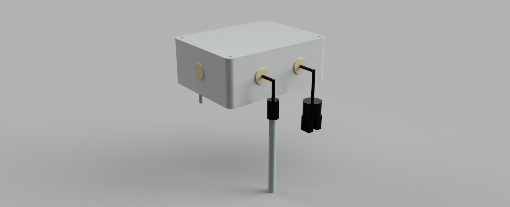
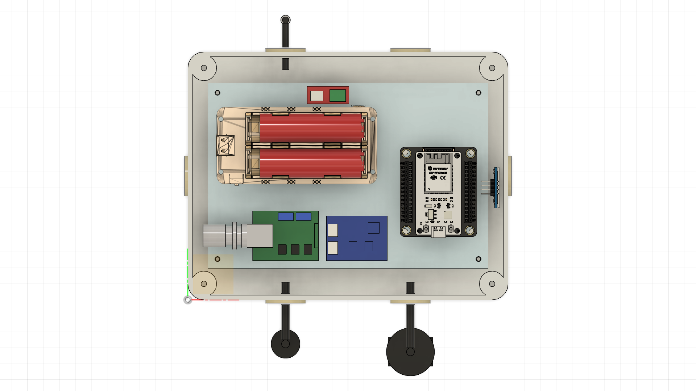
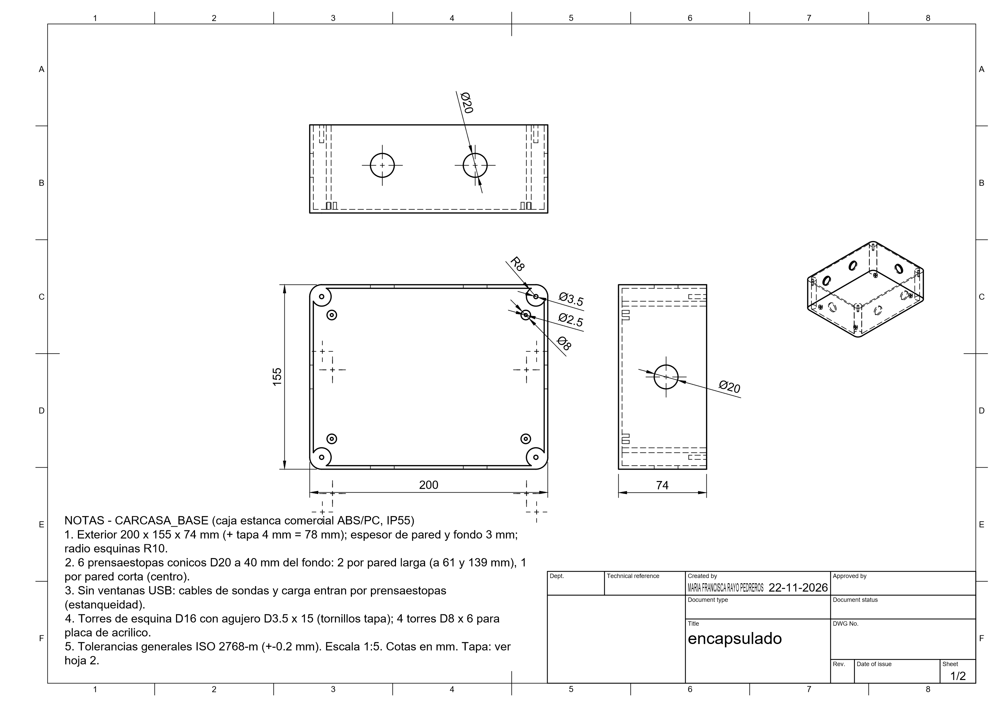
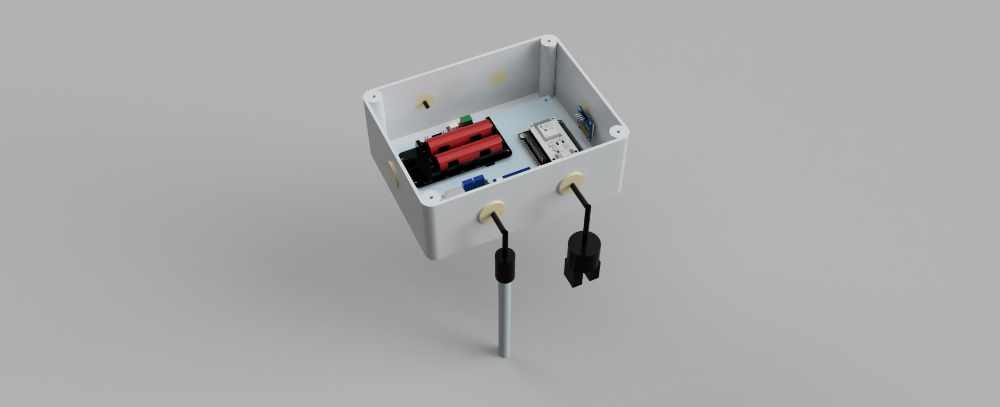
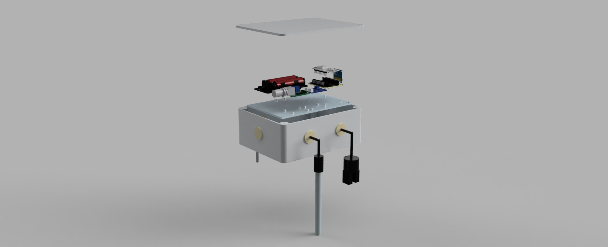

# Diseño 3D — Gemelo de AquaSafe

El gemelo 3D reproduce en Fusion 360 el prototipo físico completo: la caja estanca, la tapa, los prensaestopas, la placa de acrílico, todos los módulos electrónicos y las sondas. La ubicación de cada módulo sobre la placa es la misma que en el prototipo real.

## Archivos

| Carpeta | Contenido |
|---|---|
| `fusion360/encapsulado.f3d` | Ensamble completo, con la vista explosionada guardada en el espacio Animación |
| `fusion360/script_gemelo/GemeloAgua.py` | Script de Python (API de Fusion 360) que genera el ensamble paramétrico y revisa las interferencias |
| `fusion360/script_gemelo/GemeloPost.py` | Script que exporta el `.f3d`, las capturas y los renders |
| `fusion360/script_gemelo/interferencias.txt` | Resultado del análisis de interferencias |
| `planos/planos.pdf` | Planos técnicos A3: hoja 1, caja; hoja 2, tapa |
| `renders/` | Renders exterior, interior y explosionado; vistas del ensamble; árbol de componentes y parámetros |

## Especificaciones

- **Software:** Autodesk Fusion 360
- **Unidades:** milímetros, escala 1:1
- **Dimensiones externas:** 200 × 155 × 78 mm (base de 74 mm + tapa de 4 mm), sin contar los prensaestopas
- **Encapsulado:** caja estanca comercial IP55 con tapa atornillada; los módulos van sobre una placa de acrílico de 175 × 116 × 3 mm, con separadores
- **Fabricación:** el encapsulado no se imprime en 3D; se usan la caja comercial y una placa de acrílico cortada

## Componentes del ensamble

| Componente | Origen del modelo | Medidas (mm) |
|---|---|---|
| Caja estanca (base) | Modelado paramétrico | 200 × 155 × 74, pared 3, esquinas R10 |
| Tapa | Modelado paramétrico | 200 × 155 × 4, 4 agujeros Ø4 |
| Prensaestopas cónicos (6) | Modelado paramétrico | Ø20, ala Ø25 |
| Placa de acrílico | Modelado paramétrico | 175 × 116 × 3 |
| ESP32 DevKit 30 pines USB-C | Modelo STEP descargado | 28,5 × 53,7 × 13,7 |
| Shield de expansión ESP32 | Modelo STEP descargado | 48 × 56 × 12,6 |
| Power bank con shield 2×18650 | Modelo STL descargado | 100,6 × 49,9 × 21,4 |
| Pilas 18650 (2) | Modelado paramétrico | Ø18,5 × 65 |
| Pantalla OLED 0,96" | Modelo STEP descargado | 25,4 × 26,2 × 11,9 |
| Módulo de pH PH-4502C con conector BNC | Modelado paramétrico | 41,05 × 31,12 × 1,55 |
| Adaptador del sensor de turbidez | Modelado paramétrico | 38 × 28 × 10 |
| Adaptador del DS18B20 | Modelado paramétrico | 26 × 11 |
| Sondas de pH y turbidez, y DS18B20 | Modelado paramétrico | Electrodo Ø12 × 160; turbidez Ø30; vaina Ø6 × 50 |

Las fuentes de los modelos descargados están en `FUENTES.md`.

## Modelo paramétrico

`GemeloAgua.py` genera el ensamble completo. Todas las medidas son constantes con nombre al comienzo del script: `LX`, `WY` y `HB` para la caja, `WALL` para la pared, `PL` para la placa y una constante de posición por módulo. Si se cambia una medida y se vuelve a ejecutar el script, se regenera todo el ensamble. Las medidas principales también quedan guardadas como parámetros de usuario del diseño (*Modificar › Cambiar parámetros*).

Para ejecutarlo: *Utilidades › Complementos (Shift+S) › Scripts › +*, elegir la carpeta `script_gemelo` y luego *Ejecutar*.

## Interferencias

El análisis de interferencias (*Inspeccionar › Interferencia*) revisó 844 cuerpos y encontró **0 choques entre componentes distintos**. Los solapes que reporta Fusion son esperables:
- los pines del ESP32 dentro de los zócalos del shield, que es un acople real;
- cuerpos internos de los modelos descargados.

El power bank es una malla STL que Fusion no incluye en el análisis. Su holgura se verificó con su caja envolvente.

## Funcionalidad del encapsulado

- **Protección:** caja estanca IP55. Los cables entran solo por prensaestopas cónicos, que se ajustan al diámetro de cada cable.
- **Acceso y reparación:** la tapa sale con 4 tornillos y deja acceso directo al USB-C del ESP32, al USB del power bank y a todos los conectores. Los módulos van en zócalos y borneras, sin pegamento.
- **Tolerancias:** agujeros de paso con holgura (Ø3,2 para tornillos M3 en la placa y Ø4 para los tornillos de la tapa). Tolerancias generales ISO 2768-m (±0,2 mm), indicadas en los planos.
- **Carga:** no hay ventanas USB, para mantener la estanqueidad. Se carga con la tapa abierta o pasando el cable por un prensaestopas libre.

## Planos

`planos/planos.pdf`, formato A3, escala 1:5, con vistas ortogonales, isométrica, cotas funcionales y notas de tolerancia.

- **Hoja 1 — Caja:** 200 × 155 × 74; torres R8; prensaestopas Ø20; agujeros de tornillo Ø3,5 y Ø2,5; torres de la placa Ø8.
- **Hoja 2 — Tapa:** 200 × 155 × 4; agujeros separados 190 × 145; Ø4 con avellanado Ø7.

## Renders

Renders hechos en el espacio Render de Fusion 360, a 1920 × 1080, con una apariencia por tipo de componente.

| Exterior | Interior | Explosionado |
|---|---|---|
|  |  |  |
