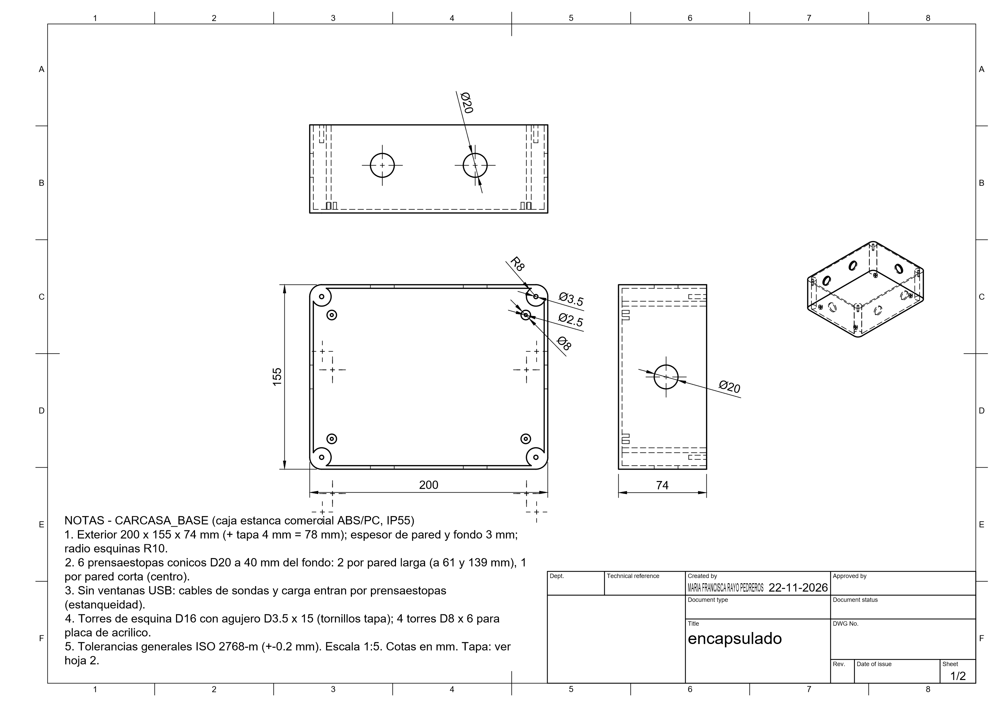
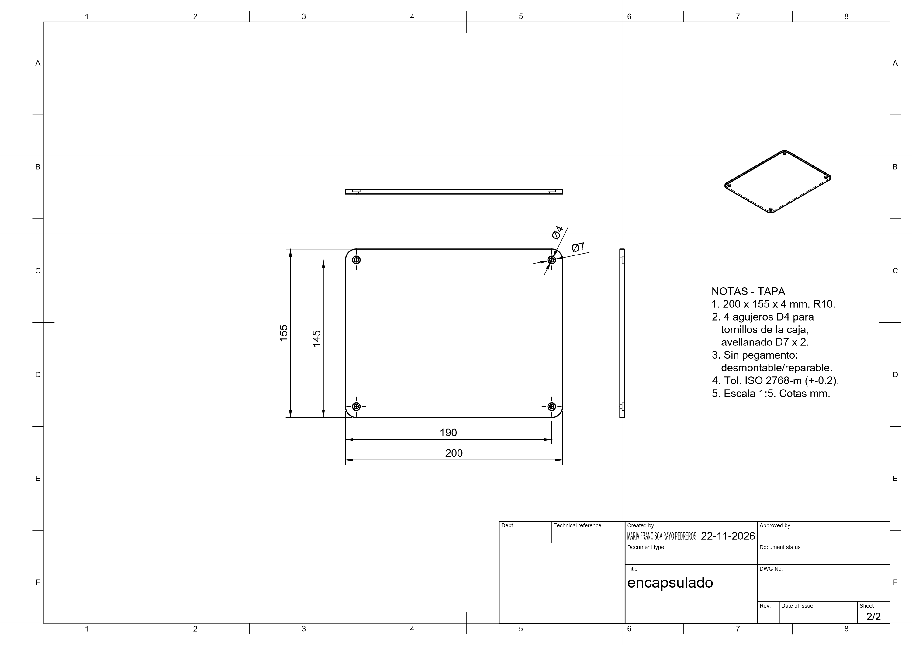

# Planos técnicos

**`planos.pdf`**: 2 hojas A3 a escala 1:5, generadas desde el modelo en Fusion 360. Cada hoja tiene vistas ortogonales, una isométrica, cotas funcionales y notas. Las tolerancias generales siguen la norma ISO 2768-m (±0,2 mm).

| Hoja | Pieza | Cotas principales |
|---|---|---|
| 1 | Caja estanca (base) | 200 × 155 × 74 mm, torres R8, prensaestopas Ø20, agujeros de tornillo Ø3,5 y Ø2,5, torres de la placa Ø8 |
| 2 | Tapa | 200 × 155 × 4 mm, agujeros separados 190 × 145 mm, Ø4 con avellanado Ø7 |

`plano_hoja1_caja.png` y `plano_hoja2_tapa.png` son imágenes de las mismas hojas, para verlas directamente en GitHub.

