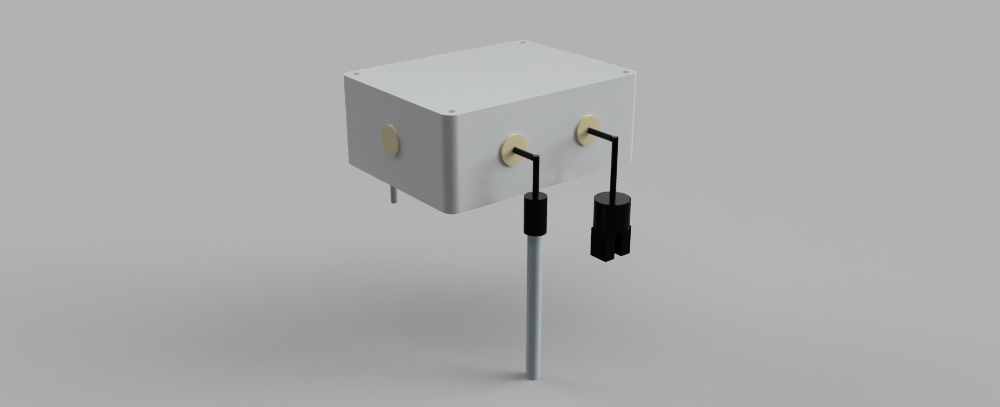
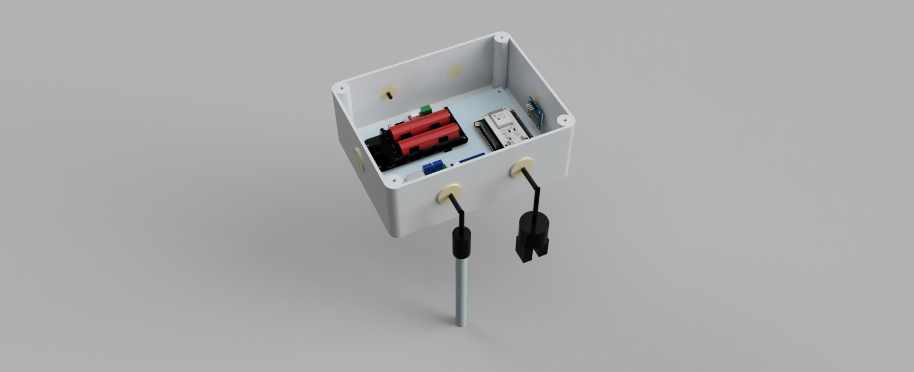
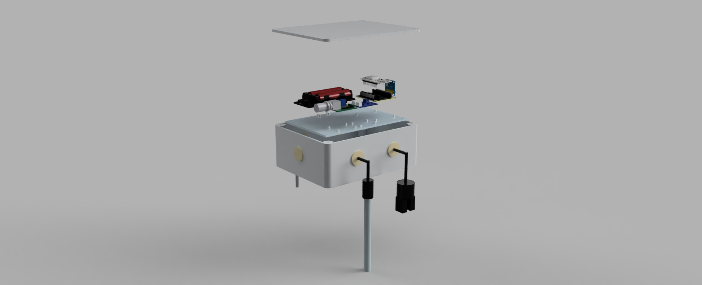

# Renders y vistas

Los renders se hicieron en el espacio Render de Fusion 360, a 1920 × 1080, con una apariencia distinta para cada tipo de componente.

| Archivo | Qué muestra |
|---|---|
| `render_exterior.png` | Caja cerrada con las sondas saliendo por los prensaestopas |
| `render_interior.png` | Interior sin tapa |
| `render_explosionado.png` | Tapa, módulos y placa separados de la caja |
| `vista_interior_iso.png` | Vista isométrica del interior |
| `vista_superior_sin_tapa.png` | Vista superior: la disposición de los módulos es la misma del prototipo real |
| `placa_con_modulos.png` | Placa de acrílico con todos los módulos, fuera de la caja |
| `fusion_arbol_componentes.jpg` | Navegador de Fusion 360 con los componentes del ensamble |
| `fusion_parametros.jpg` | Parámetros de usuario del diseño |

