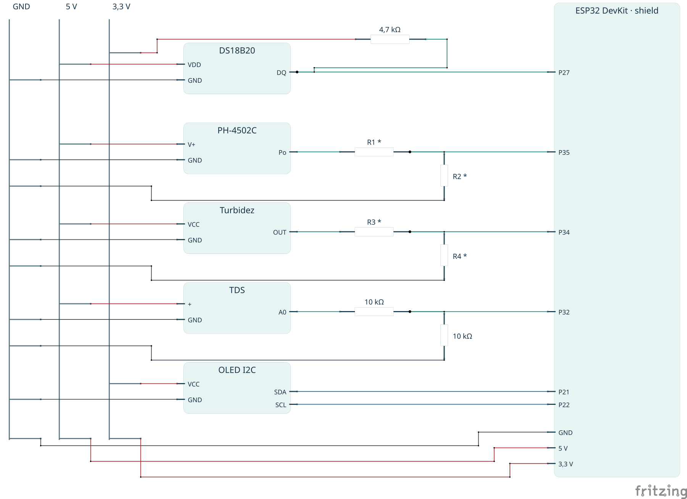

# Esquemas de Circuito

## 1. Descripción general

Esta carpeta contiene la documentación de las conexiones electrónicas del prototipo AquaSafe 

Se incluyen los archivos del esquema elaborado en Fritzing y una simulación complementaria hecha en Wokwi.

## 2. Esquema electrónico en Fritzing

El esquema representa las conexiones entre el ESP32, los sensores de temperatura, pH, turbidez y TDS, y la pantalla OLED.

También incluye las conexiones de alimentación y las resistencias usadas en el circuito.

### Visualización del esquema

### Archivos del esquema en Fritzing

- [Ver imagen del circuito](Fritzing/AquaSafe_Fritzing.png)
- [Abrir archivo editable de Fritzing](Fritzing/AquaSafe_Fritzing.fzz)

## 3. Simulación electrónica en Wokwi

Wokwi permite representar parte del funcionamiento de AquaSafe mediante una simulación.

La simulación utiliza un ESP32, un sensor DS18B20, una pantalla OLED y tres potenciómetros que simulan ser los sensores de pH, turbidez y TDS.

### Archivos de Wokwi
- [Documentación de la simulación](Wokwi/README.md)
- [Diagrama de conexiones](Wokwi/diagram.json)
- [Código Arduino de simulación](Wokwi/sketch.ino)
- [Librerías utilizadas](Wokwi/libraries.txt)

## 4. Conexiones principales
| Componente | Pin del ESP32 |
|---|---|
| Sensor de temperatura | GPIO 27 |
| Sensor de pH | GPIO 35 |
| Sensor de turbidez | GPIO 34 |
| Sensor TDS | GPIO 32 |
| Pantalla OLED SDA | GPIO 21 |
| Pantalla OLED SCL | GPIO 22 |

## 5. Consideraciones técnicas

El esquema de Fritzing representa las conexiones del circuito físico, mientras que Wokwi utiliza componentes simulados.

---

