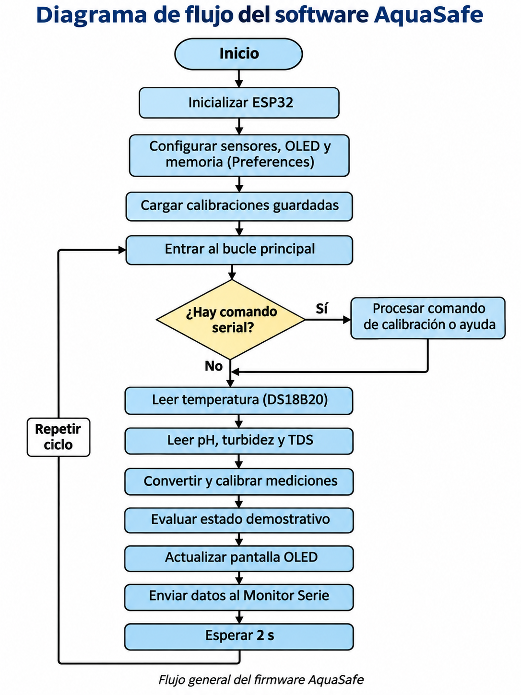

# Documentación de Software

## Contenido

### Diagramas de Flujo

El siguiente diagrama representa el funcionamiento general del firmware de AquaSafe, desde la inicialización del ESP32 hasta la lectura y visualización continua de las mediciones.

### Documentación de Funciones

#### Funciones Principales

| Función | Propósito |
|---|---|
| `setup()` | Inicializar periféricos y recuperar calibraciones. |
| `loop()` | Coordinar la lectura, el cálculo, la comunicación y la pantalla. |
| `readVoltage(pin, rawMean)` | Promediar 24 lecturas de voltaje y detectar lecturas ADC saturadas. |
| `readTemperature()` | Leer la temperatura del DS18B20. |
| `hasCalibration(c)` | Comprobar si hay dos referencias válidas. |
| `convertReading(c, signal)` | Interpolar entre dos puntos de calibración. |
| `tdsSignal(volts, temp)` | Aplicar una compensación aproximada por temperatura al TDS. |
| `readTdsPpm(...)` | Estimar TDS mediante la curva programada y, si corresponde, ajustar con patrones. |
| `handleCommand(...)` | Interpretar comandos de calibración. |
| `readCommands(...)` | Recibir órdenes desde el Monitor Serie. |
| `showOLED(...)` | Dibujar las lecturas y un estado demostrativo en la pantalla. |
| `waterStatus(...)` | Evaluar referencias de parámetros calculados para el Monitor Serie. |
| `demoStatus(...)` | Clasificar patrones empíricos de la demostración a partir de voltajes. |

---

## Manual de Instalación

## Instalación y carga del firmware

1. Instalar Arduino IDE y el paquete de placas ESP32 de Espressif.
2. Desde el Gestor de bibliotecas, instalar OneWire, DallasTemperature, Adafruit GFX Library y Adafruit SSD1306, junto con sus dependencias.
3. Abrir el archivo [AquaSafe_Final.ino](https://github.com/cjquera237/AquaSafe-TEI201/blob/main/software/AquaSafe_Final.ino)

 en Arduino IDE.

4. Conectar el ESP32 mediante USB, seleccionar la placa y el puerto correspondientes.

5. Verificar y cargar el código. Si la carga o compilación falla, revisar el modelo de placa y las versiones de las bibliotecas.

6. Abrir el Monitor Serie a **115200 baudios**, con final de línea **Nueva línea**.

**Precaución:** antes de energizar el circuito, verificar que las señales que llegan a los GPIO del ESP32 respeten los límites eléctricos y que los divisores de voltaje correspondan al montaje final.

---

## Manual de Operación

### Encendido del Sistema

1. Revisar las conexiones, la alimentación y la ausencia de humedad en los componentes electrónicos.
2. Conectar la alimentación USB al ESP32 mediante una fuente compatible. Si se utiliza el módulo Power Bank, verificar previamente la correcta instalación de las baterías y su circuito de protección.
3. Comprobar que la pantalla OLED se inicialice. Si no responde, consultar el Monitor Serie.

### Operación Normal

1. Situar las sondas en una muestra de agua conforme a las instrucciones de cada sensor.
2. Esperar a que las lecturas se estabilicen.
3. Consultar la OLED o el Monitor Serie. Revisar si los parámetros se muestran como valores calibrados, estimaciones o simples señales en voltios.
4. No interpretar los mensajes demostrativos como certificación de potabilidad.

### Apagado del Sistema

1. Retirar y limpiar las sondas siguiendo las recomendaciones de sus fabricantes.
2. Desconectar la alimentación del ESP32.
3. Guardar el prototipo con sus conexiones y sensores protegidos.

---

## Troubleshooting

### Problemas Comunes

| Problema | Comprobaciones iniciales |
|---|---|
| La OLED permanece en blanco | Revisar alimentación, GND, SDA GPIO 21, SCL GPIO 22 y dirección I2C `0x3C`/`0x3D`. |
| El DS18B20 no entrega temperatura | Revisar DATA GPIO 27, GND, alimentación y resistencia pull-up de 4,7 kΩ. |
| El pH o la turbidez aparecen sin valor físico | Verificar conexión, calibración de dos puntos y señal analógica estable. |
| El TDS aparece en voltios o fuera de rango | Verificar conexión GPIO 32, divisor resistivo, calibración y compatibilidad de la curva del sensor. |
| El Monitor Serie no muestra datos | Seleccionar el puerto del ESP32 y 115200 baudios. |
| El comando de calibración es rechazado | Utilizar minúsculas (`ph`, `tds`, `turb`, `temp`), punto decimal y final de línea «Nueva línea». |

## Almacenamiento y limitaciones

El programa usa `Preferences` para almacenar **referencias de calibración**, no para guardar el historial de cada medición. El firmware descrito aquí **no implementa un dashboard web ni almacenamiento histórico continuo**; son funciones adicionales que deben documentarse solo si el equipo efectivamente las implementa.

AquaSafe es un prototipo académico que entrega mediciones preliminares y requiere calibración y validación. **No certifica la potabilidad del agua**.
